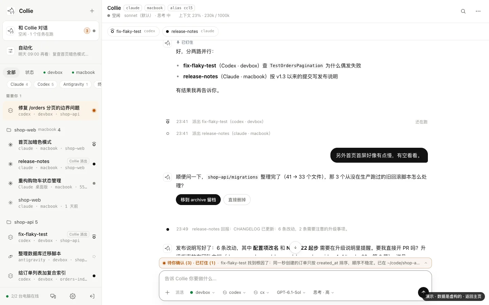
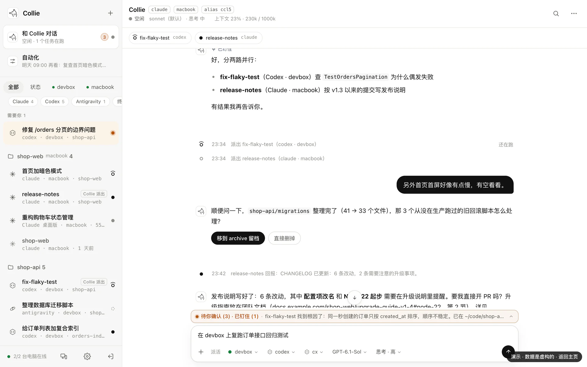
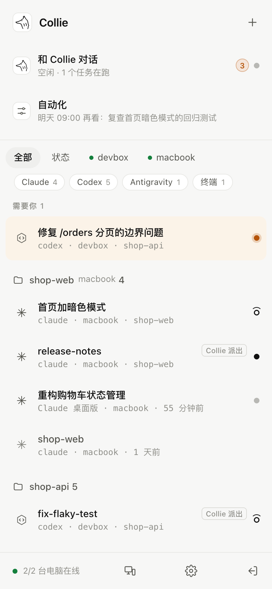
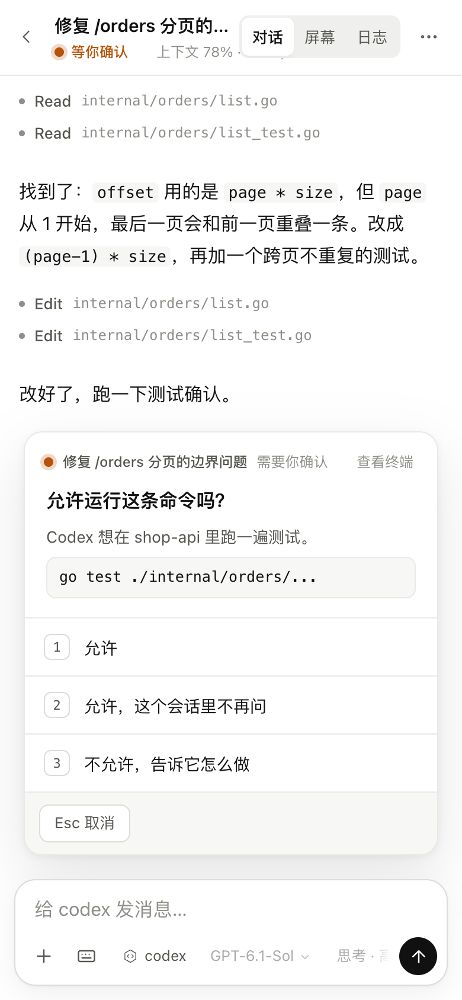
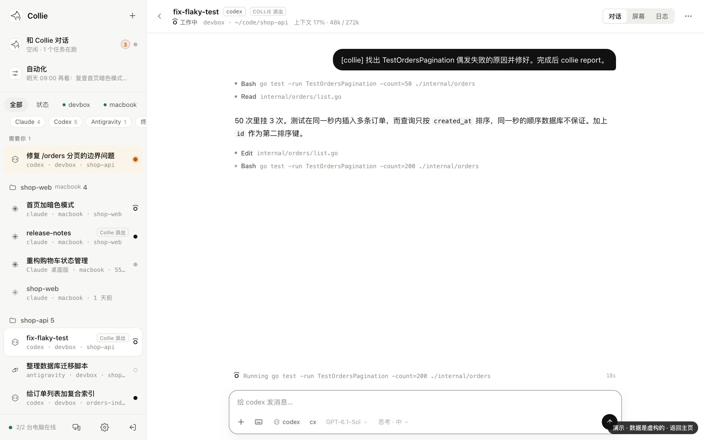

<p align="center"></p>

<h1 align="center">Collie</h1>

<p align="center"><b>在手机上养边牧，放牧一群 Agent</b><br>
Claude Code · Codex · Antigravity</p>

<p align="center">
<a href="https://collie.taoai.site/demo/"><b>▶ 在线体验</b></a> ·
<a href="https://collie.taoai.site/">主页</a> ·
<a href="#安装">安装</a> ·
<a href="https://github.com/TaoSama/collie/releases">下载</a>
</p>

电脑上开着的 Claude Code、Codex 和 Antigravity 会话，可以在手机上接着聊、看进度、处理确认。也可以直接把任务交给 Collie，让它选电脑和 Agent、并行派活，再把结果和需要你决定的事汇总到同一个对话里。

<p align="center"></p>

## 日常使用

- **和 Collie 对话**。直接描述目标。输入框里的「派活」可以为这条消息指定 worker 的电脑、Agent、启动别名、模型和思考强度。页面顶部显示 Collie 自己的模型、思考强度和上下文用量（有数据时），多台电脑接入时还会标出它运行在哪台。
- **直接管理会话**。点侧栏的「+」启动 Agent 或终端，可选电脑和工作目录，也可以带上名称与首条任务。打开 Agent 后能在对话、屏幕和日志之间切换。输入框附近显示当前 Agent 的模型和思考强度，标题区会显示可获取的上下文用量。Codex（0.164+）和 Antigravity 支持在空闲时就地切换模型，思考强度选项视模型而定。在行首或空格后输入 `/`，会列出这个 Agent 在它所在电脑和目录下能用的内置命令、技能和自定义命令，边打字边筛选，用 ↑↓、Tab 或回车选中，手机上直接点选。Codex 的技能以 `$名字` 插入。
- **在侧栏找到任务**。「全部」和电脑视图按项目分组，「状态」视图聚合需要你、进行中和完成未看的会话。还可以按 Agent 类型筛选，需要你处理的会话仍会显示。桌面右键或手机长按会话，可按会话类型重命名、标记已读或未读、复制对话 ID 或归档。
- **在手机处理确认**。可识别的终端确认框会在对话里显示为决策卡片，可以点选或用方向键和确认按钮作答，也可以打开「查看终端」核对原始画面。需要你确认或选择时，浏览器通知、飞书和 Webhook 只写任务名和要做的选择，点开直接到那张卡片；已经有人处理过的，会显示选了什么。选项不超过两个时，系统通知上可以直接点选。在「偏好设置」里可以调整主题、皮肤（默认、Codex、Linear、Kami）、字号、发送键、默认视图和浏览器通知。
- **接续其他终端里的会话**。支持的外部会话也能在侧栏打开。纯只读会话默认隐藏，可在「偏好设置」中开启「显示其他终端里的只读会话」。若看到「在 herdr 里接管」，点它会结束原终端的 Agent 进程，并在 herdr 里恢复同一会话；原来是经 shell alias 启动的，就用同一个 alias 恢复。
- **查看电脑状态**。打开「设备 → 电脑」，可查看在线状态、Agent 数量，以及可获取的 CPU、内存、网络、Token 和磁盘指标。展开电脑卡片的「详情」可查看版本和更新选项。

下面的桌面和手机截图来自 [在线体验](https://collie.taoai.site/demo/) 的模拟会话。

<table>
<tr>
<td width="62%"><br><sub><b>和 Collie 对话</b>，按项目找会话，在输入框配置派活并查看 worker 回报。</sub></td>
<td width="19%"><br><sub><b>手机列表</b>，从「需要你」找到待确认的会话，也可按电脑和 Agent 筛选。</sub></td>
<td width="19%"><br><sub><b>决策卡片</b>，查看待执行的命令，点选一项即可回复。</sub></td>
</tr>
<tr>
<td colspan="3"><br><sub><b>Agent 对话</b>，查看 Codex 的模型、思考强度、上下文用量和工具步骤。</sub></td>
</tr>
</table>

更多截图可查看 [会话菜单](docs/img/hero-dark.webp)、[设备监控](docs/img/devices.webp)、[屏幕视图](docs/img/screen.webp) 和 [自动化与记忆](docs/img/memory.webp)。

## 安装

在一台常开的 macOS 或 Linux 电脑上运行 hub，其他电脑通过 `collie node` 加入。手机、平板和浏览器访问 hub。node 主动发起出站连接，断线后自动重连，可在 NAT 后使用。

安装脚本下载 Collie 二进制，发布附带校验和时会验证下载，默认装到 `~/.local/bin/collie`。安装 hub 或 node 时，脚本会尝试安装并启动 herdr、为电脑上已安装的 Agent 补上集成，并注册后台服务（macOS 用 launchd，Linux 用 `systemd --user`）。

### 1. 启动 hub

```bash
curl -fsSL https://collie.taoai.site/install.sh | sh -s -- hub
```

用浏览器打开安装脚本给出的地址，首次登录可使用 hub 上 `~/.collie/token` 中的访问令牌。若要指定二维码和配对命令使用的地址，在安装命令末尾加 `--url` 和实际 URL。

### 2. 连接手机

在 hub 上运行 `collie pair`，或者用已登录的浏览器打开「设备 → 连接」生成二维码。用手机扫码，也可以在登录页输入 8 位配对码。配对码 10 分钟内有效，可使用一次。连接后可以把 Collie 添加到主屏幕。

### 3. 加入其他电脑

在「设备 → 连接」点击「生成连接命令」，把安装命令复制到要加入的电脑上执行。命令形如：

```bash
curl -fsSL https://collie.taoai.site/install.sh | sh -s -- node --hub http://192.168.1.20:7788 --code YOUR_CODE
```

要加入的电脑已安装 Collie 时，也可以在 hub 上运行 `collie pair --computer`，然后在那台电脑执行打印出的 `collie node` 命令。

通过安装脚本配对后，node 会保存连接信息并作为后台服务运行。每台通过配对加入的设备都有自己的访问令牌，可在「设备」页单独移除。跨网络连接时请通过 VPN、Tailscale 或 HTTPS 反向代理访问 hub。

### 4. 安装桌面应用（可选）

加入 hub 的电脑默认也在 `http://127.0.0.1:17788` 提供同一个界面。用 Chrome 打开并登录，再用浏览器的「安装 Collie」入口即可把它装成独立应用。

### 更新

在「设备 → 电脑」展开目标电脑的「详情」，有新版时可点「更新到 vX」。也可以在对应电脑上重跑安装命令。node 更新时只需传 `node`，无需重新配对。hub 如果用过 `--url` 等参数，更新时继续带上。

只安装命令，可运行 `curl -fsSL https://collie.taoai.site/install.sh | sh`。可用 `COLLIE_VERSION` 指定版本，用 `COLLIE_BIN_DIR` 指定安装目录。

### 连接多个 hub

在当前 hub 的「设备 → 连接 → 其他 hub」粘贴另一台 hub 的手机配对链接。另一台 hub 的会话会并入侧栏，并标出来源。浏览器需要能访问每台 hub，每台 hub 的 Collie 调度本 hub 连接的电脑。HTTPS 页面需要使用 HTTPS 地址访问其他 hub。

## 自动化

- 在「自动化」里查看收件箱、设置定时任务，或在「设置」中配置 Collie 和默认派活选项。
- 在「自动化 → 记忆」查看 Collie 记下的偏好、项目笔记和任务，或让 Collie 回顾最近的对话来整理记忆。
- 在「自动化 → 接入」复制 GitHub、飞书或通用 Webhook 地址。GitHub 的 Content type 选 `application/json`。通用事件向对应地址发送 JSON，可包含 `text`、`thread`、`from` 和 `id`，也可用 `X-Idempotency-Key` 去重。
- 终端里可以用 `collie say "任务"` 给 Collie 发消息，用 `collie timer ls` 查看定时任务。

本地构建、验证和维护说明见 [CLAUDE.md](CLAUDE.md)。
